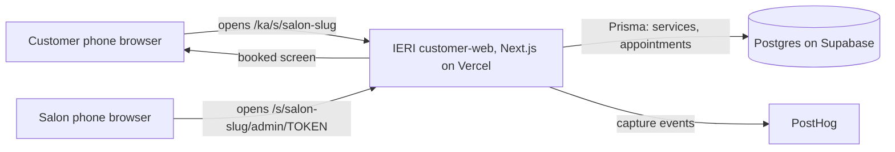

# Architecture

One diagram, one line of why per layer. The question each line answers is not "is this the best technology" but "can this team deploy it at a public URL by the Week 7 lab."

**Starting point:** Anano's IERI monorepo ([github.com/xranano/IERI](https://github.com/xranano/IERI)), a skeleton with a Next.js customer app (Georgian/English), a NestJS API, two admin apps and a Prisma schema on Supabase Postgres. For Sprint 1 we take only the customer app and the parts of the schema the journey touches, and bring them into `app/` in this repo. Everything else in IERI waits until the journey works.

## The diagram

One Next.js app does everything in Sprint 1: the public salon page, booking through server routes, and the salon's private list behind a long random token. No separate API server, no accounts, no outgoing messages.

## The stack, one line per layer

| Layer | Choice | Why we can deploy it by Week 7 |
|---|---|---|
| Hosting | Vercel | Built for Next.js; free Hobby tier; set the project's root directory to `app/`. Course guide: `Lab-6/setup/SHIP-STACK-SETUP.md`. *Team: write who has deployed on Vercel before.* |
| App framework | Next.js 16 + React 19 (IERI `customer-web`) | AK already set it up in IERI with Georgian/English (next-intl) and the IERI design tokens; server routes replace the NestJS API for Sprint 1 |
| Database | Postgres on Supabase, through Prisma | AK already created the Supabase project and the Prisma schema for IERI; we reuse its `Provider`, `Specialist`, `Service`, `User` and `Appointment` models instead of writing new tables. The course guide uses Neon; Supabase is also hosted Postgres, so only the connection string changes (`Lab-6/setup/not-nextjs.md` covers swaps). |
| Analytics | PostHog (wired from `Lab-6/setup/SHIP-STACK-SETUP.md`) | Fixed for the course |
| Messages out | None in Sprint 1 | Confirmation is shown on screen; IERI's SMS notifications are on the cut list |
| Sign-in | None | IERI plans SMS login; in Sprint 1 the customer leaves a first name and phone, and the salon uses a private tokenized link |

**Layers we deliberately do not have in Sprint 1:** the NestJS API, `provider-admin` and `platform-admin` apps, SMS login and notifications, Redis, PostGIS and maps, object storage for photos, payments and deposits.

## The journey through the stack

| Step | Layer that handles it | Event fired |
|---|---|---|
| 1 | Page `/[locale]/s/[slug]` reads the `Provider` and its active `Service` rows through Prisma | `customer_opens_salon_page` (client, with `source` from the query string) |
| 2 | Same page; choosing a service shows `durationMinutes` and `price` together, and whether removal is included | `customer_selects_service` (client, with `includes_removal`, `duration_min`) |
| 3 | Customer enters her leave-by time; the page lists today's free start times for the salon's one specialist and shows each finish (start + `durationMinutes`), marking those that end after the deadline | `customer_sets_deadline` (client, with `slots_shown`, `slots_fitting`) |
| 4 | Server route creates a guest `User` (first name, phone) and an `Appointment` with `startsAt`, `endsAt`, the service snapshots, `blockStartsAt`/`blockEndsAt`, status `CONFIRMED`, source `MARKETPLACE`; the deadline is stored on the appointment note | `customer_books_fitting_appointment` (browser, after the server returns OK; `finishes_before_deadline` and `minutes_spare` computed on the server and passed back) |
| 5 | The same server route refuses any new appointment whose block overlaps an existing one for that specialist; `/s/[slug]/admin/[token]` lists today's appointments | `system_blocks_slot` (server, with `ms_since_booking`) |

## Secrets and data

- Secrets live in: `app/.env.local` (`DATABASE_URL` from Supabase, later `NEXT_PUBLIC_POSTHOG_KEY`). IERI's `.env.example` pattern is kept: only placeholders are committed. The root `.gitignore` here already lists `.env` and `.env.*`; check again before the first push of `app/`. The Supabase service-role key is not needed in Sprint 1 and must never go in the browser.
- Personal data we store, and where: the customer's first name and phone in the `users` table only; never on an event, never in a log line, never in the repo.
- The one thing in this design most likely to break on deploy day: time zones. Vercel and Postgres run in UTC and Nino's deadline is Tbilisi time (UTC+4). If `startsAt`, `endsAt` and the deadline aren't all compared in Asia/Tbilisi, a 13:00–14:15 slot can look like it ends after 14:30, or the reverse. First check on the deployed URL in the Week 7 lab: book removal + gel at 13:00 with a 14:30 deadline and confirm it's marked as fitting, then 13:30 and confirm it isn't. Second most likely: Prisma on Vercel needs Supabase's pooled connection string, not the direct one.
